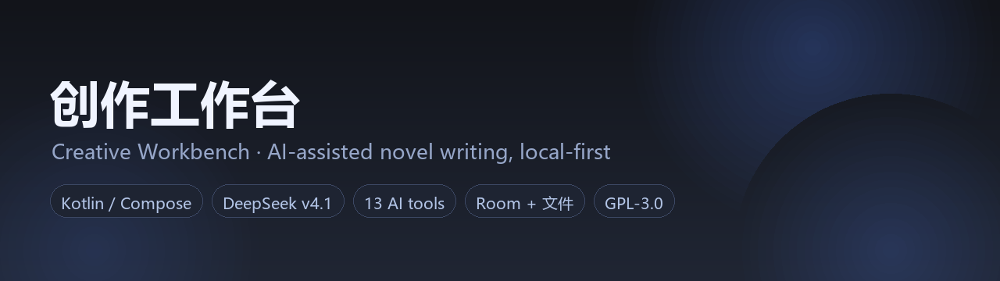

# 创作工作台（Creative Workbench）

> 一个个人自用的 Android 长篇小说写作 App：以 AI 辅助为核心，数据只存本机。
> 单机 · 无账号 · 无云同步 · GPL-3.0

## 它是什么

写给「一个人写长篇，需要一个能记住设定、能调 AI、又不把稿子传到别人服务器」的作者。

- **正文编辑器**：整章一个 EditText（一个 Editable），支持撤销/重做、段落上移下移/新建/删除、光标位置记忆、滑动惯性、长按选中后另一根手指继续滚屏。
- **AI 面板**：续写 / 改写 / 扩写 / 本章摘要 / 检查。设定（人物、世界观、伏笔）按「是否被这一章提到」**自动挑选**，也可手动勾选；四档模式（自动 / 全部 / 手动 / 关闭），偏好落盘。
- **AI 对话**：多轮、可联网检索；通过 **13 个工具**读写项目（查大纲、读/写章节、建笔记、改大纲、查伏笔……）。所有写操作先出**提案**，点「应用」才落库。
- **笔记**：六类（速记/人物/设定/灵感/片段），别名、标签、生效章节、AI 参考开关、交叉索引（提到 / 被提到）。
- **大纲**：绑定章节、目标字数、模板、结构诊断、反向大纲。
- **伏笔账本**：埋章 / 计划回收 / 实收章，未回收提醒。
- **文本导入**：粘贴或选 txt，按章切分 → AI 抽取设定 → 勾选入库（支持中文「第N章」、英文 Chapter、数字/中文序号标题）。
- **数据**：Room + 章节 JSON 文件 + journal 崩溃回放；整包备份/恢复；本章历史（每 5 分钟自动快照，可回滚）。

## 下载

- 安装包（4.05 MB，versionCode 101）：[下载 APK](https://github.com/dmqfg123/creative-workbench/blob/main/release/creative-workbench-1.0.1.apk?raw=true)（点开后右上角「Download raw file」）
- 发布页：[Releases · v1.0.1](https://github.com/dmqfg123/creative-workbench/releases/tag/v1.0.1)

> 侧载安装：Android 13+，允许「安装未知来源应用」。首次启动后到「更多 → AI 助手」填 Base URL 与 API Key。

## 技术栈

Kotlin · Jetpack Compose · 单 Activity · Room（v3）· OkHttp + SSE 流式 · kotlinx.serialization · 无第三方 UI 框架。
DeepSeek Chat Completions（含 thinking / 工具调用 / JSON 模式），也兼容任何 OpenAI 兼容端点与本机 Ollama。

## 构建

需要 JDK 17、Android SDK Platform 34、Build-Tools 34.0.0。

~~~bash
git clone https://github.com/dmqfg123/creative-workbench.git
cd creative-workbench
# 把 SDK 路径写进 local.properties（不要提交）
echo "sdk.dir=/path/to/Android/Sdk" > local.properties
./gradlew :app:testDebugUnitTest :app:assembleRelease
~~~

产物：app/build/outputs/apk/release/app-release.apk（release 用你自己的 keystore 签名，见 app/build.gradle.kts）。

## 使用前

1. 侧载安装 APK。
2. 更多 → AI 助手，填 Base URL 与 API Key（只存本机 secure 存储，不进备份、不进日志）。
3. 建作品 → 写第一章。

## 设计取向（为什么这么写）

- **默认不给模型加任何指令**：不加人设、不限题材，提示词前缀保持稳定以命中缓存；模型拒写时自动重试一次。
- **AI 不能绕过作者改数据**：所有写操作 = 提案 + 二次确认；正文写入带 revision 校验。
- **本地优先**：无云、无账号；备份是单文件（可含或不含密钥）。
- **一块编辑面**：正文只有一个 Editable，避免分段编辑器在输入法、撤销、选区上的长期坑。

## 目录

~~~text
app/src/main/java/com/creativeworkbench/writer/
├── core/        数据（Room/文件/journal）、AI（客户端/上下文/工具/检索）、备份、设置
├── ui/          编辑器、书架、笔记、大纲、AI 面板与对话、导入、设置
└── MainActivity.kt
app/src/test/    124 条单元测试
~~~

## 状态

1.0.1 已在真机（Redmi Note 11 5G / Android 13 / HyperOS）日常使用；124 条单测全绿。
已知待办见 Issues，取舍理由见项目文档与 `docs/`。

## 参与

见 [CONTRIBUTING.md](CONTRIBUTING.md) 与 [CODE_OF_CONDUCT.md](CODE_OF_CONDUCT.md)。
安全问题请走 [SECURITY.md](SECURITY.md)，不要开公开 Issue。

## 许可证

GPL-3.0（见 LICENSE）。个人作品请自留备份；本项目不对 AI 生成内容的版权做任何主张。
